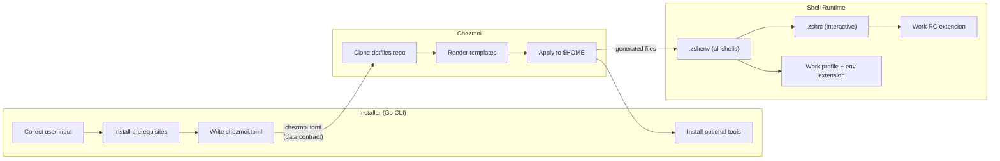

# Project Architecture

## Overview

The project has three major parts that interact through a clear data contract: a **Go installer** that bootstraps a new machine and initially produces configuration, **chezmoi templates** that consume that configuration to generate dotfiles and preserve its data during initialization, and the **resulting shell environment** that loads the generated files at runtime.

## Design Principles

- **Produce once, preserve on init**: The installer initially produces the shared [chezmoi data contract][chezmoi-data-contract]. Normal dotfile templates consume it during rendering, while the repository config template preserves its data when chezmoi initialization regenerates the config. This keeps the integration boundary explicit and makes producer-consumer drift visible.
- **Progressive enhancement**: Each part of the system degrades gracefully. Shell startup skips unavailable tools rather than failing. Chezmoi installation can fall back from the active package manager to its download script. Templates use conditionals to omit features that are not configured.
- **Separation of concerns by lifecycle**: The installer runs once (at setup time), chezmoi applies periodically (when dotfiles change), and shell config runs every session. Each part only does work appropriate to its lifecycle.

## Structure

### Installer (`installer/`)

- **Responsibility**: Bootstrap a new machine — install prerequisites, configure the shell, set up GPG, collect user input, produce the [chezmoi data contract][chezmoi-data-contract], clone and apply dotfiles
- **Boundaries**: Initially produces `~/.config/chezmoi/chezmoi.toml` as its primary output. Does not manage dotfile content — that's chezmoi's job. Does not define shell behavior — that's the templates' job.
- **Dependencies**: System package managers (apt, dnf, brew), Git, network access, `gpg`
- **Internal architecture**: See [installer architecture][arch-installer]

### Chezmoi Templates (`dot_*`, `private_dot_*`, `*.tmpl`)

- **Responsibility**: Define what dotfiles look like on the target machine. Templates use the [chezmoi data contract][chezmoi-data-contract] and chezmoi built-ins to conditionally include or exclude configuration blocks.
- **Boundaries**: Normal dotfile templates read chezmoi data (`~/.config/chezmoi/chezmoi.toml`) and write to the home directory via `chezmoi apply`; they do not modify the config. The separate repository-root `.chezmoi.toml.tmpl` regenerates the config during `chezmoi init` and `chezmoi update --init`, not during a normal apply.
- **Dependencies**: Chezmoi binary and chezmoi data initially written by the installer or preserved by the config template

### Shell Configuration (`dot_zshenv.tmpl`, `dot_zshrc.tmpl`, `private_dot_work/`)

- **Responsibility**: Configure the runtime shell environment — PATH, guarded tool integrations, plugins, [work environment][domain-work-env] loading
- **Boundaries**: These are chezmoi templates that produce shell files. At runtime, the generated files are plain shell scripts with no chezmoi dependency.
- **Dependencies**: Generated by chezmoi from templates. At runtime, progressively uses installed tools (Homebrew, sheldon, fzf, optional Python tooling, etc.) when available and skips guarded integrations when they are missing.

## Communication Patterns

### Installer → Chezmoi (data contract)

The installer initially writes `~/.config/chezmoi/chezmoi.toml`, and chezmoi exposes its `data.*` entries to source templates. During later initialization, the repository config template writes those values back while excluding chezmoi's built-in namespace; this preserves installer and unknown custom data keys. Other manually customized top-level config is not preserved. The exact keys, presence rules, and consumers are owned by the [chezmoi data contract][chezmoi-data-contract].

**Why TOML**: Chezmoi natively supports TOML config files. Viper (used by the installer) can write TOML. No translation layer needed.

### Chezmoi → Home Directory (file generation)

`chezmoi init --apply` clones the source repo and renders templates into the home directory. The template language is Go's `text/template` with chezmoi extensions. Conditional blocks use chezmoi data and built-in variables (`.chezmoi.os`, `.chezmoi.arch`, `.chezmoi.group`).

### Shell Files → Runtime (sourcing chain)

Generated shell files execute in Zsh's standard sourcing order: `.zshenv` (all shells) → `.zshrc` (interactive only). Within each file, conditional sourcing loads optional components ([work profiles][domain-work-env], [deferred Homebrew][domain-deferred-brew], tool integrations). See the [shell startup process][shell-startup] for the full flow.

## Key Design Decisions

| Decision | Choice | Rationale |
|----------|--------|-----------|
| Installer in Go | Rewrite from Bash to Go | Testability, type safety, cross-compilation via goreleaser. Bash installer was fragile and hard to maintain. |
| Chezmoi as dotfiles manager | Not bare git, stow, or yadm | Templates with conditional logic, mature tooling, good cross-platform support. The two-tier work environment model relies on chezmoi's template system. |
| Sheldon for Zsh plugins | Not oh-my-zsh framework | oh-my-zsh is used only for vendored function/plugin snippets (loaded as local files), not as a runtime framework. Sheldon is faster and more composable. |
| Deferred Homebrew loading | Split across `.zshenv` / `.zshrc` | Homebrew's `shellenv` eval is expensive (~50ms). Deferring it on macOS keeps non-interactive shells fast while still having brew available for interactive use. |
| Python tooling as optional runtime surface | Offer `uv` through optional tools and keep shell startup guarded | The dotfiles do not manage Python versions or initialize Python version-manager shims. Existing `pip`, `poetry`, and `pipx` completions remain guarded, while brew-installed uv/uvx completions are discovered through Homebrew's completion directory. |
| Fresh clone on every apply | Delete and re-clone `~/.local/share/chezmoi` | Avoids merge conflicts and stale state. The installer always applies the latest from the configured branch. |

## Diagram

[chezmoi-data-contract]: contracts/chezmoi-data.md
[domain-work-env]: dotfiles/domain.md#work-environment
[domain-deferred-brew]: dotfiles/domain.md#deferred-homebrew-loading
[arch-installer]: ../installer/docs/architecture.md
[shell-startup]: dotfiles/processes/shell-startup.md
