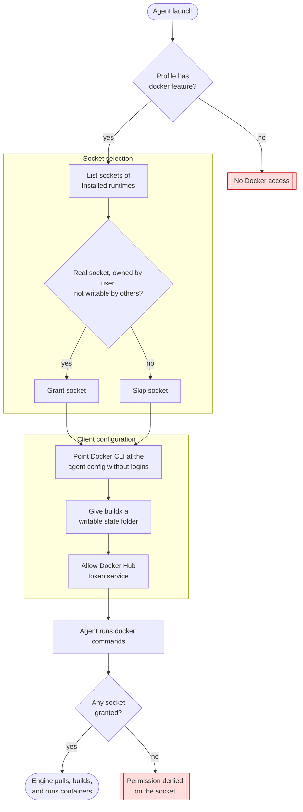

# Agent Docker Access

## Overview

Lets selected sandboxed agents use the host's Docker engine, for example to run the installer's container tests. Profiles opt in through the `docker` [agent sandbox feature][domain-features]. The agent gets the socket of each trusted, installed Docker runtime and a Docker client configuration without registry logins. Through the socket it fully controls the engine, which runs outside the sandbox.

## Trigger

An agent starts with a profile that has the `docker` feature, from either [launch path][domain-features], and later runs `docker`, `docker compose`, or `docker buildx`.

## Actors

- **Host user**: Installs and runs a Docker runtime (OrbStack, Colima, or Docker Desktop).
- **[Agent shell files][claude-wrapper]**: Declare which profiles have the `docker` feature.
- **[Shared launcher][shared-launcher]**: Selects trusted Docker sockets and prepares the Docker client environment at launch.
- **Docker CLI**: Runs inside the sandbox and talks to the engine through the granted socket.
- **Docker engine**: Runs outside the sandbox and performs pulls, builds, and container runs.

## Diagram

## Flow

### Happy Path

1. **Check the feature** — The [shared launcher][shared-launcher] checks whether the profile being launched has the `docker` feature. Profiles without it skip every step below.
2. **List candidate sockets** — The launcher keeps only the sockets of runtimes installed on the host:

   | Runtime | Installed when | Socket |
   |---------|----------------|--------|
   | OrbStack (macOS) | `OrbStack.app` is in `/Applications` or `~/Applications` | `~/.orbstack/run/docker.sock` |
   | Docker Desktop (macOS) | `Docker.app` is in `/Applications` or `~/Applications` | `~/.docker/run/docker.sock` |
   | Docker Desktop (Linux) | `/opt/docker-desktop` exists | `~/.docker/desktop/docker.sock` |
   | Colima | `colima` is on `PATH` | `${COLIMA_HOME:-~/.colima}/default/docker.sock` |

3. **Trust and grant sockets** — A candidate is granted only when the path is a real socket (not a symlink), owned by the user, and not writable by group or others. Each granted socket also bypasses nono's deny rules, which Docker Desktop sockets need because they live under `~/.docker`. `/var/run/docker.sock` usually links to one of these sockets, so the Docker CLI's default address works without extra configuration.
4. **Select the client configuration** — The launcher points `DOCKER_CONFIG` at `~/.config/docker-agent` and grants read access to it. The [agent Docker config][docker-agent-config] holds only the plugin folders, so `docker compose` and `docker buildx` are found without the user's `~/.docker/config.json`.
5. **Prepare buildx state** — The launcher points `BUILDX_CONFIG` at `~/.cache/docker-agent/buildx`, creates it, and grants write access, because the client configuration is read-only inside the sandbox.
6. **Allow Docker Hub tokens** — The launcher adds `auth.docker.io` to the sandbox's network allowlist. During a build, buildx fetches registry tokens from inside the sandbox, while plain `docker pull` and `docker run` let the engine fetch them.
7. **Use Docker** — Inside the sandbox, Docker commands reach the engine through the granted socket.

Result: the agent can pull public images, build images, and run containers, without access to the user's registry logins.

### Failure Scenarios

#### Profile lacks the feature

- **Trigger**: The profile has no `_nono_agent_enable <profile> docker` declaration.
- **At step**: 1
- **Handling**: No socket or client configuration is granted.
- **User impact**: Docker commands fail with `permission denied` on the socket.

#### No trusted socket at launch

- **Trigger**: No supported runtime is installed, the runtime is not running, or its socket fails the trust checks.
- **At step**: 2–3
- **Handling**: The socket is skipped; the launch continues.
- **User impact**: Docker commands fail with `permission denied`. Start the runtime, then restart the agent session, because grants are fixed at launch.

#### Agent configuration not applied

- **Trigger**: `~/.config/docker-agent` does not exist, for example before `chezmoi apply`.
- **At step**: 4
- **Handling**: `DOCKER_CONFIG` is not set, so the CLI falls back to the nono-denied `~/.docker`.
- **User impact**: Every Docker command warns `Error loading config file`, and runtime plugins such as `docker compose` may not be found.

#### Build uses a registry other than Docker Hub

- **Trigger**: A build pulls a base image from another registry, such as `ghcr.io`.
- **At step**: 7
- **Handling**: buildx cannot fetch that registry's token, because only `auth.docker.io` is on the allowlist.
- **User impact**: The build fails with `not in the allowlist`. Pulling the same image with `docker pull` still works, because the engine fetches its own tokens.

#### Registry login required

- **Trigger**: A command needs `docker login` or a private registry.
- **At step**: 7
- **Handling**: The agent configuration has no credentials, and logins cannot be saved to it.
- **User impact**: Private pulls and pushes fail. Public images still work.

#### Linux host (untested)

- **Trigger**: An agent runs on Linux. This process has only been tested on macOS with OrbStack.
- **At step**: 2–3
- **Handling**: Native Docker Engine is not a candidate. Its `/run/docker.sock` is owned by `root` and the `docker` group, so the user-ownership check would reject it anyway. Rootless Docker (`$XDG_RUNTIME_DIR/docker.sock`) is not a candidate either. Separately, nono does not mediate pathname Unix sockets on Linux unless a profile sets `linux.af_unix_mediation: "pathname"`, and no profile here sets it.
- **User impact**: Unverified. Any profile, with or without the `docker` feature, may reach native Docker if the user is in the `docker` group, so the opt-in may not be enforced on Linux. The agent Docker config renders without plugin folders and relies on Docker's standard system plugin folders.

## State Changes

- **Buildx state folder**: absent → `~/.cache/docker-agent/buildx` holds builder state, kept across sessions.
- **Docker engine**: images, containers, and build cache created by the agent remain after the session ends.

## Dependencies

- A running OrbStack, Colima, or Docker Desktop engine. Only OrbStack on macOS has been tested; see [Linux host (untested)][linux-untested].
- The rendered [agent Docker config][docker-agent-config] and [shared launcher][shared-launcher].
- The `docker` feature declaration in the agent shell file for each profile that needs it.

[domain-features]: ../domain.md#agent-sandbox-features
[shared-launcher]: ../../../dot_agents/shell/nono.zsh.tmpl
[claude-wrapper]: ../../../dot_agents/shell/claude.zsh
[docker-agent-config]: ../../../private_dot_config/docker-agent/config.json.tmpl
[linux-untested]: #linux-host-untested
