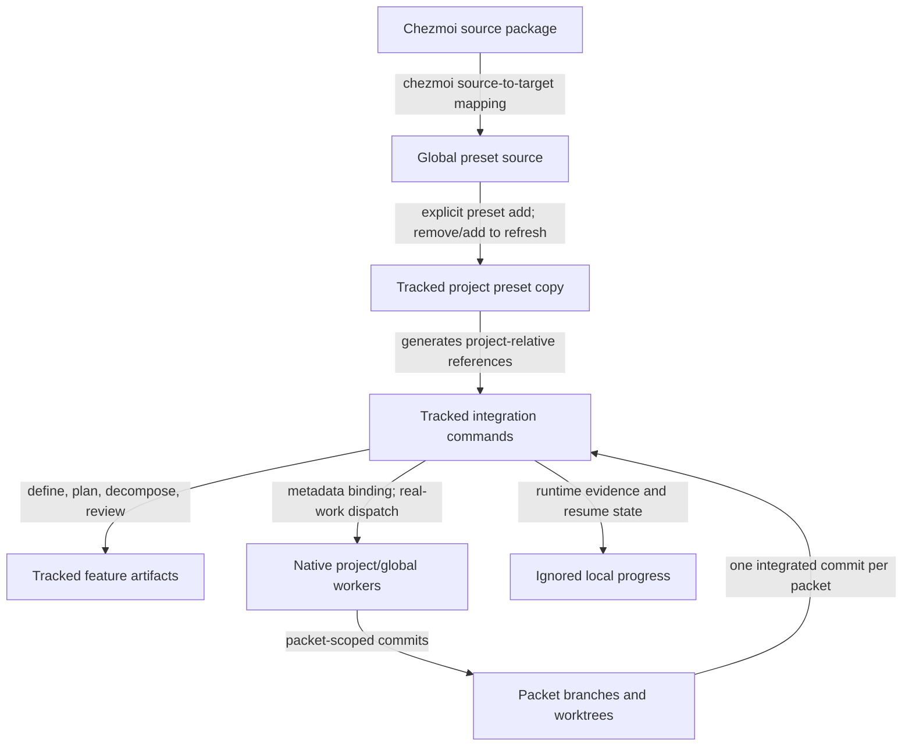

# Timor's Agentic Workflow Architecture

## Overview

`timors-agentic-workflow` is a project-installed Spec Kit preset that connects
a human-owned Feature Definition, grounded planning, a generated human plan
overview, a reviewed execution package, explicit human approval, and delegated
implementation in isolated worktrees through Markdown contracts. The preset is
provider-neutral: it defines command and artifact contracts, while the active
coding integration supplies concrete workers, models, skills, and permissions.
Its preset version is `0.5.0`; it supports Spec Kit `>=0.12.11` without an
upper support boundary.

## Source, Installation, And Activation Boundaries

The editable chezmoi source is:

```text
private_dot_config/specify/presets/timors-agentic-workflow/
```

Chezmoi maps that source to the global preset source at:

```text
~/.config/specify/presets/timors-agentic-workflow/
```

The global source is a distribution source only. Its presence does not activate
the preset in any project, and chezmoi does not install or refresh project
copies automatically.

A project activates the preset explicitly with Spec Kit's development preset
installation. Installation copies the package into the tracked project path
`.specify/presets/timors-agentic-workflow/` and generates tracked command files
for the active coding integration. Generated commands refer to the installed,
project-relative preset path rather than the global source, leaving the project
independent of the dotfiles repository after installation. Project copies stay
pinned until an operator refreshes them with an explicit remove/add.

For the OpenCode integration, those generated files are under
`.opencode/commands/`.



## Command Integration Boundary

The manifest replaces all five lifecycle commands (`/speckit.specify`,
`/speckit.clarify`, `/speckit.plan`, `/speckit.tasks`, `/speckit.implement`) and
the `spec-template`, `plan-template`, and `tasks-template` templates. Every phase
shares one protocol of artifact authorities, human gates, and invalidation rules,
so composing with upstream bodies would mix two sets of rules. The preset provides
no `/speckit.analyze`; it folds independent review and human approval into
`/speckit.plan` and `/speckit.tasks`. The stock `/speckit.analyze` resolves from a
lower layer and is not part of this lifecycle.

The other templates (grounding notes, research, plan overview, review dispositions,
review report, sub-plan, and progress) and the reviewer and writer packets are not
registered in the manifest. Commands read them by their installed project-relative
path.

Commands run no package, manifest, installed-inventory, mapping, or CLI-version
preflight. The only version requirement is the manifest's
`requires.speckit_version`. Instead, every command first resolves the canonical
feature directory, and each consumer checks the concrete fields its phase reads
and fails closed on missing, partial, contradictory, or malformed state. Old
artifacts are never migrated or inferred; they return to their owning phase or
restart the lifecycle.

The preset does not run Spec Kit extension hooks. Stock command bodies dispatch
`before_*` and `after_*` hooks from `.specify/extensions.yml`. The preset
replacements omit that mechanism, so no phase runs an extension automatically. The
git extension branch and commit hooks never fire from the workflow. An operator
runs an extension command manually when wanted.

The installed preset references are the normative source for workflow behavior and
artifact schemas. This architecture overview summarizes those boundaries without
redefining them.

### Plan Overview

`/speckit.plan` has a bound mid-tier writer generate `plan-overview.md`, a
non-normative human view of `plan.md`, twice: after the first plan draft, so the
human confirms direction before reviews, and after design and clarity reviews
pass, so the human reads the final shape before Design Acceptance. The overview
names the plan Revision it reflects, restates the Feature Definition intent,
explains only what the human needs to accept or reject the design, and lists
every other topic under Not Covered Here with a pointer into `plan.md`. The
writer never adds, changes, or settles a decision; a change of mind becomes a
`plan.md` decision and the overview is regenerated. No phase reads the overview
as input. The writer packet in `writers/plan-overview.md` owns the overview
contract.

## Artifact Ownership

The protocol separates durable planning truth from local runtime evidence:

- `spec.md` is the Feature Definition and the only authority for product intent.
  It is `Draft` or `Ready`. `/speckit.specify` writes it without asking
  questions; `/speckit.clarify` converges it through one-question human dialogue.
  It excludes repository feasibility on purpose.
- `grounding-notes.md` stores attributed repository evidence with no
  recommendations. `research.md` is tracked, non-normative working space for
  alternatives and working decisions.
- `plan.md` is the sole normative plan. It restates every decision task planning
  needs, carries a `Revision` (`R0`, `R1`, ...), the Review Record pointers, and
  the human Design Acceptance.
- `plan-overview.md` is the generated, non-normative human view of `plan.md`.
  `plan.md` prevails on conflict, and no phase reads the overview as input.
- `review-dispositions.md` records, per answered plan review batch, each
  finding's disposition and the human's reason. Only the `plan-design` and
  `plan-clarity` reviewers read it, so reruns can tie new findings to earlier
  fixes and do not raise declined findings again without new evidence.
- `tasks.md` is the execution package index. Its closed frontmatter is the sole
  machine authority for sub-plan identities, the predecessor graph, task review
  pointers, and Implementation Authorization. It holds no atomic tasks or
  checkboxes; its ledger table and Mermaid graph are human projections.
- Each indexed `subplans/` file is one packet. It owns its primary files,
  semantic model tier, required skills, test mode and basis, acceptance and
  verification, and the contracts it produces or consumes. A producer's
  sub-plan holds the only definition of each contract it produces.
- `reviews/<role-id>.md` files are tracked cumulative reviewer reports. Reruns
  append complete current-state rounds rather than replacing review history.
- `progress.md` is an ignored local ledger owned by the coordinator. It records
  concrete bindings, packet states, signing policy, the protected baseline, test
  evidence, contract outputs, blockers, and final verification.

The human approval decisions live in their owning artifacts: Design Acceptance in
`plan.md` and Implementation Authorization in `tasks.md`. The preset produces no
separate `analysis.md` aggregate.

Creating `progress.md` is the lock event. After it, the tracked feature directory
is immutable, and material `spec.md` or `plan.md` writes are refused. Before the
lock, a material Feature Definition or plan change marks Design Acceptance
`Stale`, returns authorization to `pending`, and makes affected review pointers
pending, so no gate stays valid for changed content.

This split keeps provider- and machine-specific details out of tracked planning
artifacts while preserving a reviewable package and approval record.

## Planning And Review Flow

Planning grounds repository reality before it designs, writes `plan.md`, and
generates the first overview. Task generation reads the accepted plan and creates
`tasks.md` and its indexed `subplans/` together. Before review, it applies every
closed-schema and structural check in the task-planning reference; a failure
blocks review and authorization.

Independent review runs inside two phases, not a separate command. Each producing
phase dispatches fresh-context reviewers that do not modify the artifacts they
review, and blocks its own human approval until the reviews permit it:

- `/speckit.plan` requires most-capable `plan-design`, which judges technical
  coherence of the plan, and mid-tier `plan-clarity`, which judges cold-reader
  clarity of the plan. After both pass, mid-tier `plan-overview-fidelity` checks
  that `plan-overview.md` matches `plan.md`. All three feed Design Acceptance in
  `plan.md`.
- `/speckit.tasks` requires mid-tier `tasks-plan-fidelity`, which traces the
  accepted plan and Feature Definition into the task package, and most-capable
  `tasks-executability`, which judges decomposition, dependencies, and testable
  work. Both feed Implementation Authorization in `tasks.md`.

The producing phase never applies a finding on its own judgment. It applies
wording, formatting, or citation fixes directly and lists them. Every other fix,
including one that fills a gap no human decided, is a proposed remediation that
waits for human acceptance. This keeps design decisions from entering the plan
without the human seeing them. The one exception is an overview fidelity fix that
only brings `plan-overview.md` back into agreement with `plan.md`; it changes no
decision, so the writer applies it directly.

Each role appends to its cumulative report, and the producing phase preserves
source finding ownership. At quiescence, the phase presents all current blockers
and proposed remediations in one interaction. No phase performs a fallback
self-review. Implementation remains blocked until the latest reviews are complete
and the recorded human approval authorizes it.

## Delegated Implementation Flow

Before mutation, implementation requires a Ready `spec.md`, an accepted current
plan Revision, a reviewed and approved package, and a clean, named active branch.
It resolves and pins the repository's signing policy, then creates `progress.md`,
which pins the active branch, its starting commit, and the protected baseline of
every tracked feature-directory file.

The predecessor graph in `tasks.md` frontmatter is the only scheduling authority.
Every ready packet is dispatched concurrently unless a concrete binding, harness,
resource, or workspace limit forces serialization. For each packet, the
coordinator binds an eligible native worker to the planned tier and skills,
creates a dedicated branch and worktree, and sends the packet's identity and
locator plus verified evidence for each consumed contract, not the packet text.
The worker reads its packet from the sub-plan. The coordinator does not redesign
packets or change their dependencies, ownership, contracts, tiers, tests, or
acceptance.

Workers commit only on their packet branch. The coordinator checks the returned
diff, ownership, tests, acceptance, contract-output evidence, attribution, and
the protected baseline. It then integrates packets in approved topological order:
rebase, build a separately inspectable squash candidate, verify it, and
fast-forward the active branch by exactly one policy-compliant commit per packet.
A consumer becomes ready only after its producer's final commit and contract
evidence are recorded. Nothing is pushed.

After all packets are done, aggregate verification and an independent
most-capable `component-docs` review gate completion. Bounded in-scope repairs
land as corrective commits; new scope returns to its owning phase.

## Provider-Neutral Runtime Binding

The preset neither provisions workers nor maps provider model IDs to semantic
tiers. Native project or global worker definitions own concrete models, skills,
permissions, invokability, fresh-context support, and workspace targeting;
project-local eligible definitions take precedence. The tracked plan therefore
remains portable across coding integrations, while concrete binding and
dispatch evidence stays in ignored progress or transient runtime state.

Suitability checks inspect runtime metadata and configuration only. Preflight
does not invoke a worker, calibration task, probe, canary, or sacrificial call.
The first worker invocation carries the real assigned work. Every role or packet
requires its tier, native discoverability, invokability, correct workspace
targeting, and attributable results:

- A reviewer or writer role binds the single candidate whose description matches
  the role description. A reviewer does not modify the artifacts it reviews and
  writes only its report; a writer modifies only its declared output.
- An implementation packet binds a candidate that has the skills the sub-plan
  names.

Zero or several plausible candidates become a collected blocker for one human
choice.

## Failure And Recovery Boundaries

The protocol fails closed at ownership boundaries rather than repairing state
in a later phase:

- Missing, malformed, or old task artifacts are regenerated by `/speckit.tasks`;
  invalid review reports or approval state return to their producing phase
  (`/speckit.plan` or `/speckit.tasks`).
- An incomplete review round or a role marked `Recovery required` blocks the
  phase's human gate. Ambiguous started invocations are retained for explicit
  recovery and are not automatically redispatched.
- Unsafe worker binding, worktree targeting, baseline change, test evidence,
  integration, signing, or prerequisite state blocks the affected packet and its
  dependents, while independent ready packets continue.
- Missing contract output, verification, or attributable result evidence cannot
  be replaced by inference from commits.
- Branches, worktrees, unrelated dirty files, and feature artifacts are never
  automatically stashed, discarded, reset, or deleted, and unrelated files are
  never committed. Abandonment requires an explicit human disposition and
  archives progress rather than deleting it.

## Coexistence With Existing Workflows

The existing feature-planning skills, `executing-plans`, and `plan-html` remain
separate and unchanged. The preset adapts compatible guarantees into its own
Spec Kit artifacts and installed references, but it does not invoke those
skills, consume their plan format, or depend on them at runtime.

## References

See the [preset README][preset-readme] for installation and replacement cautions.
[Artifact contracts][artifact-contracts], [plan lifecycle][plan-lifecycle],
[review lifecycle][review-lifecycle], [task planning][task-planning],
[execution lifecycle][execution], and [workspace isolation][workspace-isolation]
define their respective installed protocol contracts.

[preset-readme]: ../../private_dot_config/specify/presets/timors-agentic-workflow/README.md
[artifact-contracts]: ../../private_dot_config/specify/presets/timors-agentic-workflow/references/artifact-contracts.md
[plan-lifecycle]: ../../private_dot_config/specify/presets/timors-agentic-workflow/references/plan-lifecycle.md
[review-lifecycle]: ../../private_dot_config/specify/presets/timors-agentic-workflow/references/review-lifecycle.md
[task-planning]: ../../private_dot_config/specify/presets/timors-agentic-workflow/references/task-planning.md
[execution]: ../../private_dot_config/specify/presets/timors-agentic-workflow/references/execution-lifecycle.md
[workspace-isolation]: ../../private_dot_config/specify/presets/timors-agentic-workflow/references/workspace-isolation.md
