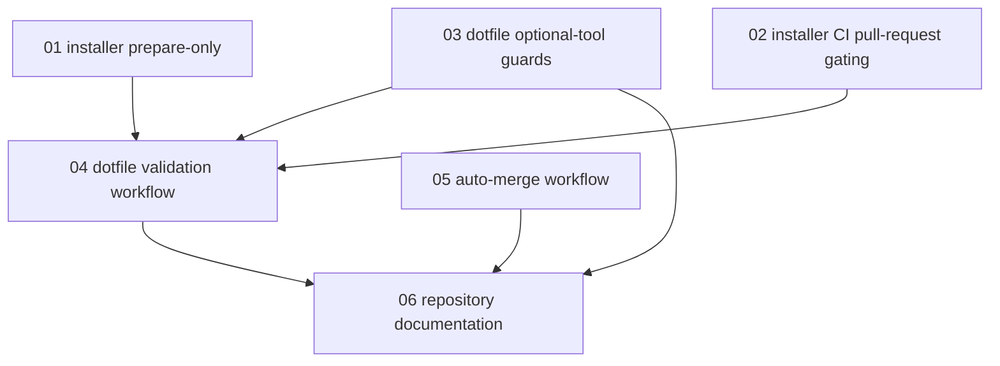

# Execution Package: Dotfile Regression CI

## Overview

This package implements accepted plan `plan.md` Revision R6 for the Feature
Definition in `spec.md`. Canonical feature directory:
`specs/001-dotfile-regression-ci/`.

The package adds the installer `--prepare-only` stop, makes Installer CI run on
pull requests only and fail on canceled jobs, guards optional tools in the
dotfiles, adds the eight-job dotfile validation reusable workflow with its
`Dotfile Validation Status` gate, adds the auto-merge workflow, and updates the
repository docs. Hosted steps (release tag, ruleset changes, hosted evidence)
happen after implement, as listed in Execution Handoff.

Integration follows ledger order, so the active branch holds one commit per
packet in this order. Consecutive commits form the three delivery pull requests:
PR A = packets 01 and 02; PR B = packets 03 and 04; PR C = packets 05 and 06.

## Sub-Plan Ledger

| Order | Path | Direct Predecessors | Objective |
|---|---|---|---|
| 1 | subplans/01-installer-prepare-only.md | None | Add `--prepare-only` with unit tests and installer process docs. |
| 2 | subplans/02-installer-ci-pull-request-gating.md | None | Run Installer CI on pull requests only; fail `Installer CI Status` on canceled jobs. |
| 3 | subplans/03-dotfile-optional-tool-guards.md | None | Guard Sheldon, the git pager, and the git external diff at use time. |
| 4 | subplans/04-dotfile-validation-workflow.md | subplans/01-installer-prepare-only.md, subplans/02-installer-ci-pull-request-gating.md, subplans/03-dotfile-optional-tool-guards.md | Add the reusable validation workflow, its caller job, the exemption output, and `Dotfile Validation Status`. |
| 5 | subplans/05-auto-merge-workflow.md | None | Add the auto-merge workflow. |
| 6 | subplans/06-repository-documentation.md | subplans/03-dotfile-optional-tool-guards.md, subplans/04-dotfile-validation-workflow.md, subplans/05-auto-merge-workflow.md | Update repository architecture, shell-startup, and domain docs. |

Ledger rows, order, paths, and direct predecessor sets exactly project frontmatter.

## Dependency Graph

This is a human projection; frontmatter alone schedules.

## Execution Inputs and Requirements

- Accepted scope: `plan.md` R6 › Design Decisions, › Contracts and Flows, and ›
  Verification Strategy. `spec.md` › Requirements and › Scope › Excluded bound
  every packet.
- Protected files: nothing under `specs/001-dotfile-regression-ci/` changes during
  implement.
- Concurrency: packets 01, 02, 03, and 05 have disjoint primary files and can run
  together. Packets 02 and 04 both own `.github/workflows/installer-ci.yml`; 04
  runs after 02 and keeps 02's changes.
- Test modes: packet 01 is `required` (Go unit tests). Packets 02 to 05 are
  `not-applicable` because their behavior is proven only by hosted runs; each
  names its local alternative verification and its hosted gap. Packet 06 is
  `no-testable-behavior`.
- Aggregate verification after all packets are integrated:
  - `go test ./...` from `installer/` passes.
  - All three workflow files parse as YAML, and shellcheck passes on
    `.github/scripts/validate-dotfiles.sh` and
    `private_dot_local/bin/executable_git-external-diff`.
  - `git diff --name-only <start commit>..HEAD` lists only files owned by the
    six packets.
- Runtime conditions: network access, Docker, `gh` authentication, and a local
  chezmoi for template rendering.

## Review Record

| Role | Report | Round | Status | Verdict |
|---|---|---|---|---|
| plan_fidelity | reviews/tasks-plan-fidelity.md | null | pending | pending |
| executability | reviews/tasks-executability.md | null | pending | pending |

## Implementation Authorization

Pending. Requested after both task reviews permit it.

## Execution Handoff

- **Component Documentation Review**: required
- **Paths or Reason**: `installer/docs/architecture.md` (cmd layer
  responsibilities and the installation flow it links),
  `installer/docs/processes/installation.md`,
  `installer/docs/processes/dotfiles-setup.md`,
  `installer/docs/processes/tools-installation.md` (describes `--install-tools`,
  whose behavior changes under `--prepare-only`),
  `docs/dotfiles/processes/shell-startup.md`, `docs/dotfiles/domain.md`, and
  `docs/architecture.md`.

Delivery after implement, from `plan.md` › Planning Handoff. Every step needs
`gh` authentication and network access. Steps marked outward-facing need the
human's confirmation immediately before they run.

1. **PR A** (packet 01 and 02 commits): open, pass, merge. Collect the
   cancellation evidence (canceling `e2e-test` fails `Installer CI Status`) and
   the trigger evidence (no Installer CI run on `main` after the merge).
2. **Release tag** (outward-facing): tag a release from `main` that contains
   `--prepare-only`.
3. **PR B** (packet 03 and 04 commits): open, pass, merge. All eight matrix jobs
   and `Dotfile Validation Status` pass on its merge commit; collect the
   empty-source and dotfile guard evidence.
4. **Release-path check**: open a throwaway draft pull request that changes one
   dotfile and no installer path. All eight jobs pass with the released
   installer and `build` skipped. Close it without merging.
5. **Hosted ruleset changes** (outward-facing): add the `pull_request` rule to
   `protect-main`, add `Dotfile Validation Status` as a non-strict required check
   in `require-installer-ci`, and remove the admin always-bypass from both.
   Collect the `gh api` evidence and a rejected direct push to `main`.
6. **PR C** (packet 05 and 06 commits): open, pass, merge. Then a passing
   non-draft pull request merges with no manual action.

- **Negative and ordering evidence** after PR B merges, each from a throwaway
  draft pull request closed without merging: unguarded `sheldon` fails the bare
  jobs; exempt-only changes pass the aggregate with matrix jobs skipped; a change
  to only `dot_claude/CLAUDE.md.tmpl` runs all eight jobs with `build` skipped;
  installer E2E stays skipped in both; a broken
  `private_dot_config/sheldon/plugins.toml` entry fails the with-tools jobs. The
  first installer pull request after PR B provides the ordering evidence.
- **Interim release rule**: after any merged pull request that changes
  `installer/**` other than `installer/docs/**` and the installer agent guides,
  the owner tags a new release.
